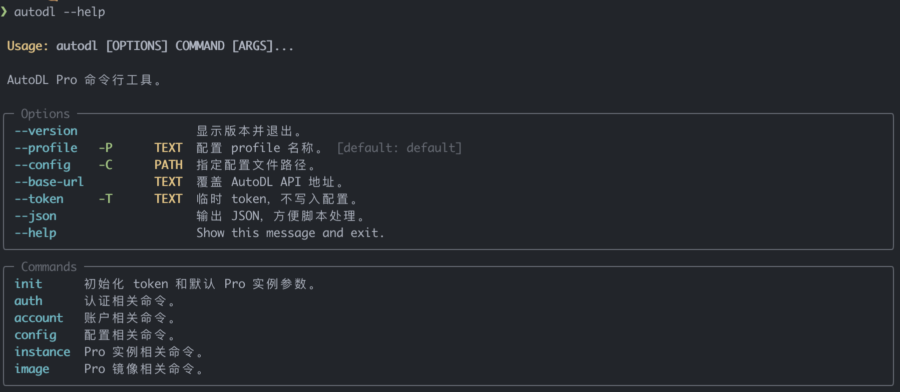

<h1 align="center">autodl-cli</h1>

一个给 AutoDL Pro 用户用的命令行工具。目标是把网页上常见的 Pro 实例操作搬到终端里：查余额、看实例、开机、关机、释放、保存镜像。

<p align="center">
  
</p>

这个项目目前专注 **AutoDL Pro 实例**，不做企业弹性部署 API，也不抓网页、不模拟网页登录。

AutoDL Pro 实例控制台：[https://www.autodl.com/console/instance/pro/list](https://www.autodl.com/console/instance/pro/list)

## 它能做什么

- 查看 AutoDL 账户余额。
- 查看当前账号下的 Pro 实例列表。
- 查看实例状态和实例详情。
- 有卡开机、关机、释放实例。
- 无库存时轮询开机，支持间隔、次数和时长限制。
- 一键 `destroy`：先关机，再释放。
- 保存实例为私有镜像。
- 查看私有镜像列表。
- 支持 `--json`，方便脚本集成。
- 默认隐藏敏感信息，例如 root 密码、Jupyter token、Authorization token。

后续计划：

- 创建 Pro 实例。
- 飞书 Webhook 通知。
- 实例状态监控。
- 定时开关机。

## 适合谁

适合经常使用 AutoDL Pro 跑训练、推理、实验的人，尤其是：

- 不想每次打开网页点开机/关机。
- 想用脚本管理实例。
- 想在服务器、笔记本或 CI 里查询 AutoDL 状态。
- 想更谨慎地管理计费实例，减少忘关机器的风险。

如果你只偶尔用一次 AutoDL，网页控制台可能已经够用。

## 安装

这个项目使用 `uv` 管理 Python 环境。

如果你只是想在当前项目目录里试用：

```bash
uv sync
uv run autodl --help
```

如果你想在项目外的任意目录使用 `autodl` 命令，推荐安装成 uv tool：

```bash
cd /Users/hang/workspace/auto-research/autodl-cli
uv tool install .
```

安装后检查：

```bash
autodl --help
autodl --version
```

`uv tool install` 默认会把工具环境安装到：

```text
~/.local/share/uv/tools
```

可执行文件会放到：

```text
~/.local/bin
```

如果安装后提示 `autodl: command not found`，说明 `~/.local/bin` 没有加入 `PATH`。可以先直接运行：

```bash
~/.local/bin/autodl --help
```

或者把它加入 zsh：

```bash
echo 'export PATH="$HOME/.local/bin:$PATH"' >> ~/.zshrc
source ~/.zshrc
```

重新安装当前项目的新版本：

```bash
cd /Users/hang/workspace/auto-research/autodl-cli
uv tool install . --force
```

你应该能看到类似这些命令：

```text
auth
account
config
instance
image
```

## 获取 AutoDL Token

这个工具不支持用户名密码登录。AutoDL 官方 API 使用开发者 Token。

你需要到 AutoDL 控制台里找到开发者 Token。一般路径是：

```text
AutoDL 控制台 -> 账号/设置 -> 开发者 Token
```

拿到 token 后再初始化配置。

## 5 分钟上手

### 1. 初始化

默认会优先把 token 存进系统密钥链；如果当前 Linux/headless 环境没有可用
keyring，会自动改用本地 token 文件：

```bash
uv run autodl init
```

命令会提示你输入 token。输入时不会明文显示。

如果你想明确指定保存方式，也可以手动选择：

```bash
uv run autodl init --token-store keyring
uv run autodl init --token-store file
```

本地 token 文件会放在用户数据目录下，并尽量设置为只有当前用户可读写。

如果你在没有系统 keyring 的机器上强制使用 `--token-store keyring`，命令会报错；
这时请使用默认的 `auto` 或明确指定本地文件：

```bash
uv run autodl init --token-store file
```

### 2. 检查 token 是否可用

```bash
uv run autodl auth check
```

### 3. 查看余额

```bash
uv run autodl account balance
```

如果你想把结果给脚本处理，加 `--json`：

```bash
uv run autodl --json account balance
```

### 4. 查看实例列表

```bash
uv run autodl instance list
```

### 5. 查看某个实例状态

```bash
uv run autodl instance status <instance_uuid>
```

### 6. 查看某个实例详情

```bash
uv run autodl instance inspect <instance_uuid>
```

输出会自动隐藏敏感字段。

如果确实需要查看 root 密码、Jupyter token 等敏感字段：

```bash
uv run autodl instance inspect <instance_uuid> --show-secret
```

请避免在共享终端、CI 日志或命令历史中暴露这些输出。

## 常用命令

### 账户

```bash
uv run autodl auth check
uv run autodl account balance
```

### 实例

查看实例：

```bash
uv run autodl instance list
uv run autodl instance list --stock
uv run autodl instance status <instance_uuid>
uv run autodl instance status -n <instance_name>
uv run autodl instance inspect <instance_uuid>
uv run autodl instance inspect <instance_uuid> --show-secret
```

`--stock` 会额外尝试调用弹性部署 GPU 库存接口，并按实例的地区和 GPU 规格做匹配。
该库存接口属于弹性部署能力，AutoDL 文档标注需要企业认证；普通 Pro 账号可能只能看到
`unknown`。

`status`、`inspect`、`start`、`stop`、`release`、`destroy` 都支持 `-n/--name`
按实例名称操作。实例名称需要先在 AutoDL 控制台设置；如果当前实例没有名称或找不到匹配项，
命令只会输出提示，不会继续执行开机、关机或释放。

创建实例功能暂时下线，待重新核对 Pro API 参数后再开放。当前建议先在 AutoDL 网页控制台创建实例，再用本工具查询、开机、关机、释放和保存镜像。

开机：

```bash
uv run autodl instance start <instance_uuid>
uv run autodl instance start -n <instance_name>
```

带启动命令开机：

```bash
uv run autodl instance start <instance_uuid> \
  --start-command "bash /root/start.sh"
```

无卡开机（网页接口，仅支持主账号）：

```bash
# 隐藏输入网页登录 Token，与开发者 Token 分开保存
uv run autodl auth web-token
# 或从已有文件导入
uv run autodl auth web-token --token-file ~/.local/share/autodl/web.token

uv run autodl instance start -n pro-3090 --no-gpu
uv run autodl instance stop -n pro-3090
```

网页登录 Token 获取方式：登录 AutoDL 控制台，打开浏览器开发者工具，进入
Application → Local Storage → `https://www.autodl.com`，复制 `token` 的值。
不要把 Token 提交到仓库或发到聊天中。

`auth web-token` 支持 `--token-store auto|keyring|file`，默认优先使用系统密钥链，
不可用时保存到用户数据目录的 `<profile>.web.token`，文件权限为 `0600`。
通过全局 `--profile` 选择配置；网页与开发者 Token 使用独立的密钥链服务和文件。
Token 失效后重新运行 `auth web-token`。`config show` 不显示 Token。

`--no-gpu` 使用 `https://www.autodl.com/api/v1/instance/pro/power_on`，
发送 `payload=non_gpu`。该网页内部接口可能随网页更新而变化。
实例应为按量计费且处于可开机状态；服务端校验是否允许开机。
网页提示配置为 0.5 核 CPU、2 GB 内存，配置费用 ¥0.10/小时，最低消费 ¥0.01。
使用 UUID 时只需网页登录 Token；使用 `-n` 时还需开发者 Token 查询实例名称。
无卡开机不支持 `--wait`、轮询参数或 `--start-command`，失败后不会自动尝试有卡开机。
全局 `--token` 和 `--base-url` 仅用于官方 API，不覆盖网页开机的 Token 和地址。
默认不加 `--no-gpu` 时仍通过官方 API 有卡开机。

无库存时轮询开机：

```bash
uv run autodl instance start <instance_uuid> --wait
uv run autodl instance start -n <instance_name> --wait --interval 20 --max-attempts 100
uv run autodl instance start <instance_uuid> --wait --timeout 3600
```

首次立即尝试。默认间隔为 15 秒，每次随机波动 ±10%（13.5–16.5 秒）。
`--interval` 和 `--timeout` 的单位均为秒，支持小数。
未指定次数或时长时，默认等待 1800 秒（30 分钟）。仅指定 `--max-attempts` 时，
只限制次数；首次请求计入次数。同时指定次数和时长时，先达到哪个限制就停止。
时长包含请求和等待时间；到期后不再发起新请求，正在进行的请求会等待返回。
仅库存不足会重试，其他错误立即退出。Ctrl+C 可取消等待。
每次无库存且将继续等待时，向 stderr 追加一行：尝试次数、已等待时间和下次重试间隔。
使用普通换行，不覆盖旧行，也不每秒刷新，便于 agent 和日志工具读取。
成功后输出开机成功和尝试次数。
达到限制时以退出码 1 退出。
`--json` 模式仅输出最终结果，包含 `ok`、`attempts` 和 `message`。
成功以开机 API 返回 `Success` 为准，不额外等待 SSH 或应用服务就绪。

关机：

```bash
uv run autodl instance stop <instance_uuid>
```

释放实例：

```bash
uv run autodl instance release <instance_uuid>
```

这是高危操作，会释放实例资源。请先确认实例内重要数据、镜像和任务状态已经处理完毕。

跳过确认直接释放：

```bash
uv run autodl instance release <instance_uuid> --yes
```

`--yes` 只会跳过交互确认，不代表操作更安全。CLI 仍会在 stderr 打印高危警告。

先关机再释放：

```bash
uv run autodl instance destroy <instance_uuid>
```

这是高危操作，会先关机再释放实例资源。请先确认实例内重要数据、镜像和任务状态已经处理完毕。

跳过确认直接关机并释放：

```bash
uv run autodl instance destroy <instance_uuid> --yes
```

### 镜像

查看私有镜像：

```bash
uv run autodl image list
```

保存实例为私有镜像：

```bash
uv run autodl image save <instance_uuid> --name <image_name>
```

## 全局参数

这些参数可以放在 `autodl` 后面、子命令前面。

指定配置 profile：

```bash
uv run autodl --profile default account balance
```

临时传入 token，不写入配置：

```bash
uv run autodl --token "$AUTODL_TOKEN" account balance
```

输出 JSON：

```bash
uv run autodl --json instance list
uv run autodl instance list --json
```

面向脚本或 AI agent 时，请优先使用 `--json`。默认表格输出是给人看的，不保证适合机器解析。

`instance list --json` 会返回稳定的 key-value 结构，列表项会包含规范化字段：

```json
{
  "list": [
    {
      "uuid": "pro-xxx",
      "name": "train-job",
      "status": "running",
      "gpu_spec_uuid": "4090",
      "gpu_amount": 1
    }
  ],
  "page_index": 1,
  "page_size": 20,
  "total_count": 1,
  "total_page": 1
}
```

指定配置文件：

```bash
uv run autodl --config ./config.toml account balance
```

查看版本：

```bash
uv run autodl --version
```

## 关于开机、释放和计费

请特别注意：

- `instance start` 默认有卡开机；`--no-gpu` 无卡开机，两者都可能产生费用。
- `instance release` 是高危操作，会释放实例资源。
- `instance destroy` 是高危操作，会先关机再释放实例资源。
- 使用 `--yes` 会跳过交互确认，适合脚本，但请只在你非常确定目标实例时使用。

建议新用户先只运行这些只读命令：

```bash
uv run autodl auth check
uv run autodl account balance
uv run autodl instance list
uv run autodl image list
```

确认 token 和输出都正常后，再使用开机、释放命令。

## Pro API 能不能获取机器列表？

当前实现使用的是 AutoDL Pro 官方公开 API。

Pro API 支持获取“当前账号下的 Pro 实例列表”：

```text
POST /api/v1/dev/instance/pro/list
```

这不是平台物理机器列表，也不是全站 GPU 库存列表。

也就是说：

- 可以列出你自己账号下已有的 Pro 实例。
- 不会去抓取 AutoDL 的网页。
- 不会获取其他用户或平台机器池。
- 不会绕过 AutoDL 的调度逻辑。

如果需要在列表中附带库存信息，可以尝试：

```bash
uv run autodl instance list --stock
```

这个选项会额外调用弹性部署 GPU 库存接口。该接口和 Pro 实例列表接口不是同一类能力，
AutoDL 文档标注需要企业认证；普通 Pro 账号可能无法获取准确库存。

因为 AutoDL Pro 是算力和数据分离，通常不需要“抢某一台机器”。等待/重试基于官方 Pro API，默认每 15 秒尝试一次，并加入随机间隔。

## 常见问题

### 没有 token 怎么办？

去 AutoDL 控制台获取开发者 Token，然后运行：

```bash
uv run autodl init
```

### 不想保存 token 怎么办？

可以每次临时传入：

```bash
uv run autodl --token "$AUTODL_TOKEN" account balance
```

### 输出里为什么看不到 root 密码和 Jupyter token？

为了避免误泄漏，CLI 默认会隐藏敏感字段。

### 为什么没有 Webhook？

Webhook 会做，但不是第一批核心功能。当前先完成账户、实例、镜像这些基础能力。

### 为什么没有创建实例命令？

创建实例接口参数和实际 Pro 行为还需要继续核对。为了避免命令直接报错，或者误触发计费操作，`instance create` 暂时下线，标记为待实现。

### 为什么没有企业弹性部署 API？

这个项目第一阶段只做 AutoDL Pro 实例。企业弹性部署 API 权限和使用场景不同，暂时不混在一起。

## 开发

运行测试：

```bash
uv run pytest
```

运行 lint：

```bash
uv run ruff check .
```

查看 CLI 帮助：

```bash
uv run autodl --help
```

设计文档在：

```text
docs/autodl-pro-cli-design.md
```
